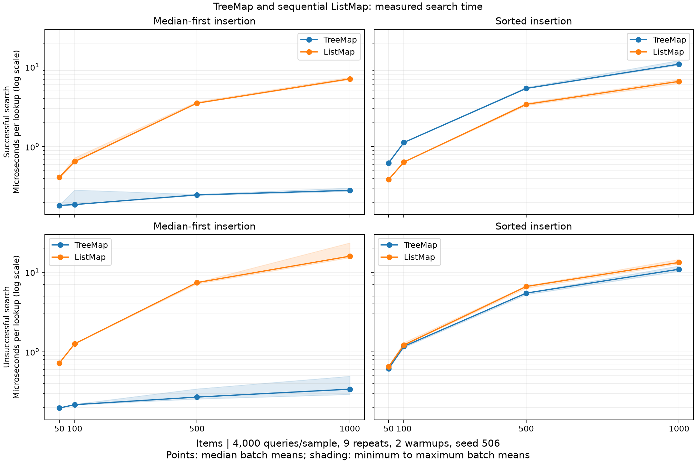

# TreeMap

**A modular Python toolkit for Binary Search Trees and tree-based Maps.**

> **Status:** Complete — v1.0.2 release
>
> **Language:** Python 3.11+
>
> **Development:** Four-day milestone project

## Overview

**TreeMap** is an educational software engineering project that implements a Binary Search Tree (BST) and a Map backed by that tree. It demonstrates ordered key-value storage, tree manipulation, traversal, balance detection, visualization, and search-performance analysis. The repository directory is `treemap`; Python imports use `treemap`.

The implementation emphasizes modularity, clear interfaces, automated tests, and reproducible benchmarks. **The initial BST is not self-balancing**: balance detection reports problems but does not perform rotations.

## Features

Implemented features:

- **BST:** Insert, search, delete, find minimum/maximum, and preserve the BST ordering invariant.
- **Generic nodes:** Comparable keys, unrestricted values, and typed child references.
- **Traversal:** Iterative in-order, pre-order, and post-order node iterators.
- **TreeMap:** Complete key-value API with sorted collections and stored `None` support.
- **Balance analysis:** Height, root balance factor, overall balance, and unbalanced node keys.
- **ListMap:** Sequential lookup with the same valid-key API as TreeMap.
- **Visualization:** Deterministic ASCII diagrams before and after deletion.
- **Benchmarking:** Reproducible hit/miss searches, raw samples, environment metadata, and a PNG chart.
- **Validation:** Six explicit 50-item scenarios, strict ancestor bounds, deep trees, dictionary comparisons, and strict static type checks.
- **Development setup:** Installable package, virtual environment, pytest, Ruff, and a runnable example.

The [two-page evaluation](docs/evaluation.pdf), [editable source](docs/evaluation.md),
and [requirements matrix](docs/REQUIREMENTS.md) accompany the implementation.

## Technology

Python 3.11+ and Git are required for development. The installed library has no
third-party runtime dependencies. The `dev` extra supplies pytest, Ruff, mypy,
package-build tools, and Matplotlib for the complete validation workflow.
The `docs` extra supplies PDF generation and inspection tools. Runtime checks
use the available CPython 3.14.4 interpreter; mypy targets Python 3.11 syntax.
Graphify is an optional, separate analysis tool.

## Repository structure

```text
treemap/
├── src/
│   └── treemap/
│       ├── __init__.py
│       ├── py.typed
│       ├── core/
│       │   ├── __init__.py
│       │   ├── node.py
│       │   ├── bst.py
│       │   ├── operations.py
│       │   ├── traversals.py
│       │   └── balance.py
│       ├── maps/
│       │   ├── __init__.py
│       │   ├── tree_map.py
│       │   └── list_map.py
│       └── visualization/
│           ├── __init__.py
│           └── tree_renderer.py
├── tests/
│   ├── conftest.py
│   ├── test_bst.py
│   ├── test_traversals.py
│   ├── test_tree_map.py
│   ├── test_balance.py
│   ├── test_datasets.py
│   ├── test_list_map.py
│   ├── test_tree_renderer.py
│   ├── test_benchmark_search.py
│   ├── test_submission.py
│   └── test_edge_cases.py
├── benchmarks/
│   └── benchmark_search.py
├── examples/
│   └── demo.py
├── docs/
│   ├── IMPLEMENTATION_PLAN.md
│   ├── requirements.md
│   ├── architecture.md
│   ├── performance_analysis.md
│   ├── evaluation.md
│   ├── evaluation.pdf
│   └── diagrams/
├── results/
│   ├── performance_results.csv
│   └── benchmark_chart.png
├── scripts/                  # PDF generation, release validation, submission archive
├── pyproject.toml
├── .gitattributes
├── .gitignore
└── README.md
```

The layout highlights the main deliverables; `results/` also retains raw samples,
environment/source metadata, and regression evidence. Generated release archives
and package distributions are written to the ignored `dist/` directory.

## Getting started

From the repository directory:

```bash
# Create a virtual environment
python -m venv .venv

# Activate it on macOS/Linux
source .venv/bin/activate
# Or on Windows PowerShell:
# .venv\Scripts\Activate.ps1

# Install project and development dependencies
python -m pip install -e ".[dev]"

# Optional: rebuild and inspect the evaluation PDF
python -m pip install -e ".[docs]"
```

On Windows, activation is optional: use `.venv\Scripts\python.exe` in place of
`python` if PowerShell script execution is disabled.

For example, without PowerShell activation:

```powershell
.venv\Scripts\python.exe -m pip install -e ".[dev]"
.venv\Scripts\python.exe -m pytest -v
```

## API

The BST and TreeMap APIs below are implemented.

### Binary Search Tree

```python
from treemap.core.bst import BinarySearchTree

tree = BinarySearchTree()
for key in [50, 30, 70, 20, 40, 60, 80]:
    tree.insert(key, f"value-{key}")

assert tree.search(40).value == "value-40"
assert tree.minimum().key == 20
assert tree.maximum().key == 80
assert tree.delete(30) == "value-30"
assert len(tree) == 6
```

### TreeMap

```python
from treemap.maps.tree_map import TreeMap

mapping = TreeMap()
mapping.put("alpha", 10)
mapping.put("beta", 20)
mapping.put("alpha", 15)  # Update an existing key

assert mapping.get("alpha") == 15
assert mapping.contains_key("beta")
assert mapping.keys() == ["alpha", "beta"]
assert mapping.values() == [15, 20]
assert mapping.items() == [("alpha", 15), ("beta", 20)]
assert mapping.remove("beta") == 20
assert len(mapping) == 1

mapping.put("optional", None)
assert mapping.contains_key("optional")
assert mapping.get("optional", "fallback") is None
assert mapping.get("missing", "fallback") == "fallback"
```

**Key policy:** Keys within a tree must have a stable total ordering with consistent equality and `<`; inserting an existing key updates its value without changing size. Do not use NaN keys or mutate stored keys. Values may have different types, including `None`.

**BST results:** `insert` returns `None`. `search` returns a `TreeNode`, or `None`
for a missing key, so stored `None` values remain distinguishable from absence.
`delete` returns the removed value and raises `KeyError` for a missing key.
`minimum` and `maximum` return nodes and raise `ValueError` on an empty tree.
`len(tree)` counts distinct keys. See [architecture](docs/architecture.md) for
the key contract, node-reference behavior, and operation complexity.

**TreeMap results:** `put` returns `None`; `remove` returns the removed value
and raises `KeyError` if absent. `keys`, `values`, and `items` return new lists,
ordered by key, containing references to the stored keys and values.
`mapping.root` exposes the underlying root for traversal, balance analysis, and
rendering. The property cannot be assigned; callers must also leave node keys
and child links unchanged. The public package includes a `py.typed` marker.

`ListMap` is available from `treemap` or `treemap.maps.list_map`. It offers the
same methods for valid, mutually comparable keys, storing entries in a list
and scanning sequentially. Lookup/update/removal are O(n); sorted collections
are O(n log n). TreeMap operations depend on tree height. Both retain stored
`None` values and return the supplied default only for an absent key.

## Traversal example

For insertion order `50, 30, 70, 20, 40, 60, 80`:

```text
         50
       /    \
     30      70
    /  \    /  \
   20  40  60  80
```

| Traversal | Expected key order |
|---|---|
| In-order | 20, 30, 40, 50, 60, 70, 80 |
| Pre-order | 50, 30, 20, 40, 70, 60, 80 |
| Post-order | 20, 40, 30, 60, 80, 70, 50 |

```python
from treemap import BinarySearchTree
from treemap.core import analyze_balance, inorder, postorder, preorder

tree = BinarySearchTree()
for key in [50, 30, 70, 20, 40, 60, 80]:
    tree.insert(key, f"value-{key}")

for traversal in [inorder, preorder, postorder]:
    print([node.key for node in traversal(tree.root)])

report = analyze_balance(tree.root)
print(report.height, report.is_balanced, report.unbalanced_keys)
assert report.height == 2
assert report.is_balanced
```

Each traversal accepts a subtree root, yields the actual nodes, and returns an
empty iterator for `None`. The self-contained example rebuilds the seven-node
tree, so its output matches the table.

Height counts edges: empty tree **−1**, leaf **0**. Balance factor is
`height(left) - height(right)`. `analyze_balance` returns the tree's height,
root balance factor, overall `is_balanced`, and a tuple of unbalanced keys in
post-order. It checks every subtree and performs no rotations. The convenience
functions `height(root)`, `balance_factor(root)`, and `is_balanced(root)` are
also available from `treemap.core`.

## Tests and code quality

After installation, run:

```bash
python -m pytest -v
python -m ruff check .
python -m ruff format --check .
python -m mypy

# Run the maps, algorithms, and before/after ASCII diagrams
python examples/demo.py
```

Tests cover empty/single-node trees, every deletion shape, missing keys, duplicate
updates, heterogeneous values including `None`, multiple comparable key types,
and strict bounds/size after mutations. All six named datasets exercise at least
50 entries or 50 updates. Seeded workloads compare the maps against a dictionary.
Deep-tree checks exceed the recursion limit. Balance tests use an independent
breadth-first height reference, and renderer tests verify the saved diagrams.
Benchmark tests validate workloads and statistics without asserting a speed threshold.

Both `pytest` and `python -m pytest` are supported. The committed
[JUnit report](results/pytest_results.xml) records the full run. Python 3.11 is
the syntax/type-check target; runtime verification uses Python 3.14.4.
Final verification passed **213 tests**, strict mypy, Ruff lint/format, dependency
checks, the demo, the two-page PDF check, and reconstruction of all benchmark
statistics. See [release validation](results/final_validation.json).

## Performance evaluation

The executed benchmark uses **50, 100, 500, and 1,000** entries, median-first
and sorted insertion, and identical successful/unsuccessful queries for both
maps. Each result is the median of nine batch means, with 4,000 queries per
batch, two warmups, and fixed seed 506. Construction is outside timing.

```bash
python benchmarks/benchmark_search.py
# Without the optional plotting dependency:
python benchmarks/benchmark_search.py --no-chart
# Preserve the published snapshot when measuring again:
python benchmarks/benchmark_search.py --output results/reproduced
```

The results are per-lookup batch averages, not individual-operation latency
percentiles. Favorable tree shape helps TreeMap; sorted insertion produces a
chain and can make sequential lookup competitive. See the
[performance analysis](docs/performance_analysis.md) for the final measured
values, exact methodology, uncertainty, and practical implications.



Evidence: [summary CSV](results/performance_results.csv),
[288 raw samples](results/benchmark_samples.csv),
[environment and source hashes](results/benchmark_metadata.json), and
[installed versions](results/benchmark_environment.txt). Re-running replaces
the benchmark evidence in `results/`; exact timings vary with the environment.

| Search structure | Typical behavior | Worst case |
|---|---|---|
| Reasonably balanced BST | O(log n) | O(n) across arbitrary BST shapes |
| Degenerate BST | O(n) | O(n) |
| Unsorted list-backed Map | O(n) | O(n) |

Median-first insertion deliberately constructs a favorable shape; the BST
does not rebalance itself. Measurements cover this implementation and workload,
not a universal speed advantage or proof of asymptotic complexity.

## Reproducible tree diagrams

```python
from treemap.visualization import render_tree

print(render_tree(tree.root))
print(render_tree(tree.root, show_values=True))
```

The renderer labels left/right links, escapes labels to ASCII, and handles
empty and deep trees without recursion. Checked-in diagrams show the seven-node
example [before deletion](docs/diagrams/tree_before.txt) and
[after deleting 30](docs/diagrams/tree_after.txt), using successor 40.

## Documentation

Detailed planning and project evidence are maintained separately from this README:

- [`docs/IMPLEMENTATION_PLAN.md`](docs/IMPLEMENTATION_PLAN.md) — four-day tasks, quality gates, and commit schedules.
- [`docs/REQUIREMENTS.md`](docs/REQUIREMENTS.md) — requirement-to-evidence traceability.
- [`docs/architecture.md`](docs/architecture.md) — module design and core interfaces.
- [`docs/performance_analysis.md`](docs/performance_analysis.md) — executed benchmark methodology, results, and limits.
- [`docs/evaluation.pdf`](docs/evaluation.pdf) — two-page academic evaluation, including APA-style citations and references.
- [`docs/evaluation.md`](docs/evaluation.md) — editable evaluation source.
- [`docs/SUBMISSION.md`](docs/SUBMISSION.md) — validation and release-artifact guide.
- [`docs/diagrams/`](docs/diagrams/) — reproducible before-and-after tree diagrams.

## Project knowledge graph

Graphify outputs are available in [`graphify-out/`](graphify-out/):

- [`graph.html`](graphify-out/graph.html) — interactive architecture graph; open in a browser.
- [`graph.json`](graphify-out/graph.json) — graph data with sources and confidence labels.
- [`GRAPH_REPORT.md`](graphify-out/GRAPH_REPORT.md) — communities, cohesion, connections, and audit limitations.

The checked-in graph is the **Day 2 snapshot**, before ListMap, the renderer,
and the benchmark were implemented. It is not a current Day 3 architecture graph
or a correctness proof; re-run graphify to refresh it.
Graph labels and paths use the current project and package names; the Day 2 relationships are unchanged.
Graphify's token counters are unavailable here; no measured token cost is claimed.

## Completion criteria

All requirements are implemented and mapped to evidence in the
[requirements matrix](docs/REQUIREMENTS.md). The final repository has 23
milestone commits plus submission corrections, with the lightweight release tag `v1.0.2`.

## Rebuild documentation and prepare a submission

```bash
python -m pip install -e ".[dev,docs]"
python scripts/build_evaluation.py
python -m build
```

The PDF builder uses 12-point Times, double spacing, one-inch margins, page
numbers, and hanging references. It checks the exact two-page limit. Windows
Times New Roman fonts are embedded when available; standard PDF Times fonts
are the portable fallback. The two-page limit includes references, with no
separate title page or invented student details.

After the release tag exists, `python scripts/build_submission.py --tag v1.0.2`
creates the source ZIP, Git-history bundle, and SHA-256 manifest in `dist/`.
The archive is built from committed files, so virtual environments and caches
are excluded. The bundle preserves all milestone commits and the release tag.

## Future improvements

Potential extensions include AVL or red-black balancing, breadth-first traversal, property-based tests, and additional benchmark comparisons.

---

**TreeMap** — Build, test, visualize, and analyze tree-based data structures in Python.
