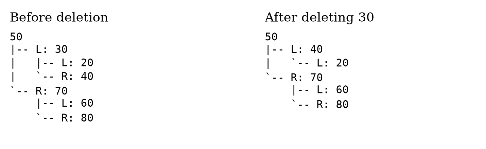
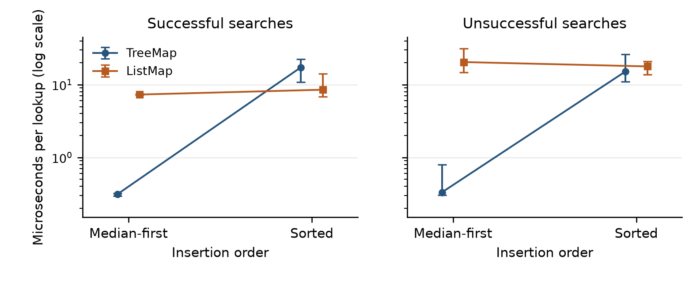

# TreeMap: Design, Verification, and Performance Evaluation of a Binary Search Tree-Based Map

## Abstract

TreeMap is a modular Python project that implements a binary search tree (BST) and an ordered key-value Map. The project evaluates algorithmic correctness, software organization, and the effect of tree shape on search performance. An iterative BST provides insertion, searching, deletion, and extrema; separate modules implement traversal, balance analysis, and ASCII visualization. Automated verification includes 213 passing tests, six scenarios containing at least 50 entries or updates, ancestor-bound invariant checks, and independent reference comparisons. Search benchmarks compare TreeMap with a sequential ListMap at 50, 100, 500, and 1,000 entries. Fixed workloads, warmups, and repeated batches produce 32 summary cases and 288 measured samples. At 1,000 entries, median-first insertion produced substantially faster TreeMap lookups, whereas sorted insertion made successful TreeMap searches slower than ListMap. The findings demonstrate that ordered access can justify tree storage while also showing that an ordinary BST offers no unconditional logarithmic guarantee. Requirement and success-criterion matrices connect the completed implementation to its retained evidence. The report distinguishes measured behavior from theoretical complexity and identifies limits on generalization.

<!-- pagebreak -->
<!-- body -->

A tree organizes information through relationships among nodes, with a root providing the starting point for navigation. A binary search tree adds an ordering rule: every key in a node's left subtree precedes that node's key, and every key in its right subtree follows it. This rule makes tree shape relevant to the work required for searching and updates (Sedgewick & Wayne, 2011). TreeMap applies this model to an educational implementation whose behavior can be inspected, tested, and measured.

The central question is whether the completed system combines reliable ordered storage with defensible evidence about performance. The answer depends on both algorithmic behavior and software quality. Accordingly, this report examines implementation contracts, diverse test data, reproducible measurements, documentation, and the acceptance criteria supplied for the project. Results refer to the recorded version 1.0.2 evidence (*TreeMap*, 2026); later documentation additions do not alter the measured lookup algorithms.

## Project Scope and Completion Standards

The required scope includes generic nodes, BST construction and mutation, three traversals, height and balance analysis, TreeMap, ListMap, visualization, tests, and performance analysis. The completion document defines 17 functional requirements, 10 testing requirements, eight performance requirements, 10 software engineering requirements, 18 deliverables, and 12 overarching success criteria. Appendix A maps the requirement and deliverable identifiers to concrete artifacts. Appendix B separately evaluates SC-01 through SC-12.

Automatic rebalancing, database integration, graphical interfaces, and cloud deployment remain outside scope. Excluding these features makes the effect of ordinary BST shape observable. Detection of imbalance therefore satisfies the specified requirement without implying that AVL or red-black rotations were implemented. The original two-page evaluation remains a separate required artifact; this longer report provides additional analysis and traceability.

## Modular Architecture and Design Decisions

The source layout places the installed package in `src/treemap`. The `core` modules contain nodes, tree ownership, subtree operations, traversal, and balance analysis. The `maps` modules expose TreeMap and ListMap. Visualization depends on the node representation rather than on private Map storage. Tests, demonstrations, benchmark code, documentation, and recorded results occupy separate top-level directories.

`TreeNode` is a generic dataclass with key, value, left, and right fields. A comparable-key protocol expresses the ordering contract; values may be heterogeneous and may include `None`. All keys in a tree must be mutually comparable and maintain stable ordering. Unsupported combinations, such as integer and string keys, can raise `TypeError`. Type hints express expectations but do not establish the mathematical ordering laws of arbitrary user-defined objects.

`BinarySearchTree` owns the root and unique-key count. TreeMap delegates storage and mutation to one BST, avoiding a second independent collection or size counter. The public root property enables inspection but does not authorize direct mutation of node keys or child links. This division of responsibility supports independent tests and keeps the Map interface separate from structural algorithms.

## BST Operations and Map Semantics

Insertion descends through comparisons until it finds an existing key or an empty child position. An existing key replaces its value without increasing size. Search follows the corresponding branch and returns a node or `None`. Returning a node distinguishes a missing key from an entry whose stored value is `None`. Minimum and maximum follow the leftmost and rightmost branches, respectively, and raise `ValueError` on an empty tree.

Deletion handles a leaf, one child, two children, and replacement of the root. For two children, the implementation consistently uses the in-order successor. In the demonstrated tree, deleting 30 substitutes key 40 and reconnects the remaining links. An unsuccessful deletion raises `KeyError` without changing size. These contracts are exercised by targeted cases and longer mutation sequences.

TreeMap exposes `put`, `get`, `remove`, `contains_key`, `keys`, `values`, `items`, and `len`. Retrieval returns the supplied default only when the key is absent. Removal returns the removed value and raises `KeyError` if absent. Collection methods return new lists ordered by key, retaining references to the stored values. ListMap provides the same valid-key Map contract through a list and sequential equality checks, making it an appropriate implementation-level comparator.

## Traversal, Balance Detection, and Visualization

In-order traversal visits left subtree, node, and right subtree, yielding ascending keys. Pre-order visits the node before its descendants; post-order visits descendants before the node. Separate iterator calls produce repeatable sequences and accept either a subtree root or an empty root. Explicit stacks support deep trees without relying on recursive Python calls.

Height counts edges: an empty tree has height -1 and a leaf has height 0. Balance factor equals left-subtree height minus right-subtree height. The analyzer evaluates every subtree in iterative post-order and reports height, the root factor, overall balance, and unbalanced keys. Checking only the root would miss hidden descendant imbalance. Python defines a finite interpreter recursion limit, which supports the decision to use iterative operations for intentionally skewed inputs (Python Software Foundation, n.d.).

Figure 1 shows diagrams generated from actual renderer output. Explicit left and right labels make child relationships inspectable, and deletion changes can be checked against both known diagrams and strict ordering bounds. The renderer also handles empty trees and can include values. It supports explanation and debugging, while automated checks provide the broader correctness evidence.

**Figure 1**

*BST Structure Before and After Deleting Key 30*

*Note.* Both diagrams are produced by the implementation. The in-order successor 40 replaces 30; six entries remain afterward.

## Testing Strategy and Correctness Evidence

The recorded regression suite contains 213 tests, with zero reported failures, errors, or skips. Table 1 summarizes the six named dataset scenarios. Integer and string keys are tested in separate compatible trees; mixed value types test storage flexibility without requiring mixed key comparisons. Duplicate updates begin with 50 stored keys and then perform 50 replacements.

**Table 1**

*Required and Supplemental Dataset Scenarios*

| Scenario | Size | Main verification purpose |
| --- | --- | --- |
| Random integer keys | 50 entries | General insertion, retrieval, and deletion behavior |
| Sorted integer keys | 50 entries | Right-chain construction and worst-case shape |
| Reverse-sorted integer keys | 50 entries | Left-chain construction and opposite degeneration |
| String keys | 50 entries | Alternative comparable key type |
| Mixed values | 50 entries | Integers, strings, floats, lists, dictionaries, booleans, and None |
| Duplicate updates | 50 replacements after 50 preloads | Replacement semantics and stable unique-key count |

Unit cases cover empty and single-node trees, missing keys, all deletion shapes, extrema, traversal orders, and balanced or skewed structures. Integration cases verify TreeMap's observable behavior, including sorted collections and stored `None`. Seeded mutation workloads compare results with an independent dictionary. Balance tests use a breadth-first height reference; renderer tests compare saved diagrams with newly generated output.

The invariant helper carries strict lower and upper ancestor bounds to every node, checks unique node ownership, and compares reachable nodes with the stored size. These checks can expose structural or bookkeeping errors that output comparisons alone do not explain. Tests also exceed the active recursion limit. Passing these cases supports the defined acceptance criteria; it does not constitute a proof for every possible input or a measured statement-coverage percentage.

## Benchmark Methodology

The benchmark uses 50, 100, 500, and 1,000 entries, with median-first and sorted insertion orders. Both Maps receive equivalent keys, values, and hit/miss queries. Keys are even integers, allowing unsuccessful interior queries to use odd gaps. Misses also include values below the minimum and above the maximum. Twenty percent of stored values are `None`, so correctness checks must distinguish stored values from the missing-key sentinel.

Seed 506 fixes workload generation and measurement ordering. Each case receives two warmup batches and nine measured batches of 4,000 searches, producing 32 summary cases, 288 samples, and 1,152,000 timed lookups. Construction, query generation, correctness checks, tree-height calculation, plotting, and file writing are outside timing. Garbage collection is disabled during measurement and restored afterward; the order of Map measurements is shuffled between repetitions.

Each batch uses prebound public `get` calls and a nanosecond performance counter. Dividing batch elapsed time by query count yields a mean time per lookup. The reported median is the median of nine batch means, with minimum, maximum, and inclusive-quartile IQR also retained. Measurements used CPython 3.14.4 on Windows with 24 logical processors. Metadata preserves source and CSV hashes and identifies source revision `b0a20d4`; the raw evidence remains distinct from theoretical predictions.

## Measured Results

Table 2 presents microseconds per lookup, converted from the recorded nanosecond summaries. Median-first tree heights were 5, 6, 8, and 9; sorted heights were 49, 99, 499, and 999. Figure 2 highlights the 1,000-entry comparison and observed batch ranges.

**Table 2**

*Median Search Times by Size and Insertion Order*

| Items / order | TreeMap hit | ListMap hit | TreeMap miss | ListMap miss |
| --- | ---: | ---: | ---: | ---: |
| 50 / Median-first | 0.173 | 0.379 | 0.193 | 0.673 |
| 100 / Median-first | 0.195 | 0.672 | 0.237 | 1.279 |
| 500 / Median-first | 0.263 | 3.639 | 0.287 | 7.431 |
| 1,000 / Median-first | 0.313 | 7.321 | 0.332 | 20.466 |
| 50 / Sorted | 0.584 | 0.353 | 0.611 | 0.650 |
| 100 / Sorted | 1.143 | 0.655 | 1.156 | 1.258 |
| 500 / Sorted | 5.465 | 3.418 | 5.489 | 6.488 |
| 1,000 / Sorted | 17.305 | 8.531 | 15.145 | 17.839 |

*Note.* Times are microseconds per lookup. Each median summarizes nine batch means, with 4,000 lookups per batch. The tree is not automatically rebalanced.

At 1,000 entries with median-first insertion, TreeMap hits took 0.313 microseconds compared with 7.321 for ListMap; the ratio based on unrounded values was 23.42. For misses, corresponding medians were 0.332 and 20.466, a ratio of 61.70. With sorted insertion, successful TreeMap searches took 17.305 microseconds versus 8.531 for ListMap, making the list about 2.03 times faster for that case.

Sorted TreeMap hits were approximately 55.35 times slower than median-first TreeMap hits. Sorted TreeMap still had a lower median than ListMap for the mixed miss workload. A below-minimum miss terminates immediately at the root of a right chain, so the miss distribution matters. These findings support a conditional advantage from favorable shape rather than a universal claim that tree storage is faster.

**Figure 2**

*Measured TreeMap and ListMap Search Times at 1,000 Entries*

*Note.* Points show median batch means; vertical bars show observed minimum and maximum batch means. The vertical scale is logarithmic. All values come from the retained project measurements.

## Complexity, Practical Benefits, and Limitations

BST search and mutation follow paths whose cost depends on height. A reasonably balanced tree supports logarithmic paths, whereas a chain permits linear paths. Random insertion of distinct keys has expected logarithmic search behavior under the usual random-order model; that model is not a guarantee for arbitrary update histories (Sedgewick & Wayne, 2011). This experiment deliberately controls favorable and unfavorable shapes instead of timing random insertion.

For this implementation, BST insertion, search, deletion, minimum, and maximum require O(h) time and O(1) auxiliary space, where h is height. Traversals require O(n) time and O(h) working space. Balance analysis requires O(n) time, O(h) working space, and space for reported unbalanced keys. TreeMap collections require O(n) time plus their result lists. ListMap lookup and unique-key updates require O(n); its sorted collections require O(n log n). These bounds follow from the implemented loops, traversals, and sorting steps.

Ordered traversal is useful for maintaining sorted records while accommodating changes. Node relationships also support explanations of hierarchical navigation. However, a search tree organizes key order rather than automatically modeling containment relationships in a domain. Practical indexing often needs additional guarantees: PostgreSQL documents a balanced, multiway B-tree index, which differs from this ordinary binary implementation (PostgreSQL Global Development Group, n.d.). That application illustrates the value of ordering without equating the project to a production database index.

The 1,000-entry measurements show substantial variation, particularly for sorted searches and misses. For example, median-first ListMap miss batches ranged from 14.839 to 31.450 microseconds per lookup. One process, machine, interpreter, and integer-key workload cannot establish a general speed ratio. CPU state, scheduling, caches, and background activity were not controlled completely. Memory use, construction costs, expensive key comparisons, and update performance were not benchmarked. Explicit stacks avoid recursion failures but do not correct poor shape or remove storage overhead.

## Software Engineering, Reproducibility, and Release

The four-day plan establishes six foundation commits, six traversal/Map commits, six testing/performance commits, and five documentation/release commits. The supplied requirements label the approach PSEPF Level 1, or lightweight hybrid agile; its retained evidence comprises milestone planning, acceptance gates, and incremental history. The 23 planned milestone commits are retained, followed by meaningful naming and submission corrections. Version control exposes incremental development rather than only a final file dump. The completed branch and version tags were synchronized with GitHub; generated environments and caches are excluded.

Quality evidence includes Ruff lint and formatting checks, strict mypy checks, dependency verification, a runnable demonstration, and clean wheel-install verification. The `dev` optional extra supports the documented validation workflow; the runtime library has no third-party dependencies. Python 3.11 is the declared minimum and static target, while the recorded runtime checks used 3.14.4. Compatibility with every supported interpreter has not been established by this single environment.

Reproduction begins with `python -m pip install -e ".[dev]"`, followed by `python -m pytest -v`, Ruff checks, and `python examples/demo.py`. The benchmark's `--output results/reproduced` option preserves the submitted evidence while producing a new run. README, the detailed user guide, architecture notes, requirements matrix, performance analysis, and the two-page evaluation explain the workflow. A versioned ZIP, Git bundle, wheel, source distribution, and checksums support review and transfer.

## Assessment Against the Success Criteria

SC-01 through SC-06 concern correctness, traversal, Map behavior, manipulation, balance, and data compatibility. Their evidence combines targeted tests, 50-item datasets, structural bounds, and independent references. SC-07 addresses performance through equivalent workloads, recorded results, a chart, and qualified interpretation. SC-08 and SC-09 concern modularity and quality, supported by the package structure and executed checks.

SC-10 through SC-12 address documentation, incremental history, and reproducible readiness. All 18 specified deliverable locations are represented in the submission. The original two-page evaluation remains intact alongside this expanded report. Appendix B records each criterion's evidence and its practical boundary. Completion means that the specified scope passed its defined verification, without extending that claim to automatic balancing, universal performance superiority, or exhaustive correctness proof.

## Conclusion

TreeMap fulfills the project's ordered-storage and educational objectives through a modular BST, a reusable Map interface, traversal and balance algorithms, visualization, and retained verification evidence. Its principal analytical result is that tree shape governs the value of tree-based lookup: favorable structure supports efficient search, while degeneration can make a sequential list competitive or faster. The success criteria are supported by implemented behavior, diverse datasets, measured comparisons, documented reproduction, and release artifacts. Future work should prioritize balancing, broader runtime verification, and independent benchmark replications before making stronger operational claims.

<!-- references -->
## References

PostgreSQL Global Development Group. (n.d.). *B-tree indexes*. PostgreSQL 18 documentation. https://www.postgresql.org/docs/18/btree.html

Python Software Foundation. (n.d.). *sys—System-specific parameters and functions*. Python 3.14 documentation. https://docs.python.org/3.14/library/sys.html#sys.getrecursionlimit

Sedgewick, R., & Wayne, K. (2011). *Algorithms* (4th ed.). Addison-Wesley Professional.

*TreeMap* (Version 1.0.2) [Computer software]. (2026). GitHub. https://github.com/Shreyash2942/treemap/tree/v1.0.2

<!-- appendix: requirements -->
## Appendix A

### Requirements and Deliverable Traceability

The following tables connect every numbered requirement and deliverable in `docs/REQUIREMENTS.md` with the completed implementation or retained verification. “Verified” refers to the defined project checks; the limits discussed in the report still apply. Paths are relative to the repository root.

**Table A1**

*Functional Requirements*

| ID | Requirement | Evidence or required location |
| --- | --- | --- |
| FR-01 | Tree Node Implementation | Generic TreeNode dataclass; field and type-contract checks. |
| FR-02 | BST Construction | BinarySearchTree root ownership and unique-key count; empty and populated cases. |
| FR-03 | BST Insertion | Iterative insertion; strict bounds after selected mutations. |
| FR-04 | BST Searching | Node-or-None search contract; existing, missing, and stored-None cases. |
| FR-05 | BST Deletion | Leaf, one-child, two-child, and root deletion; successor and repeated-removal tests. |
| FR-06 | Minimum Value | Leftmost-node helper; empty, subtree, and repeated-extrema tests. |
| FR-07 | Maximum Value | Rightmost-node helper; empty, subtree, and repeated-extrema tests. |
| FR-08 | In-Order Traversal | inorder iterator; exact ascending sequences and empty/deep cases. |
| FR-09 | Pre-Order Traversal | preorder iterator; exact parent-first sequences and repeatability. |
| FR-10 | Post-Order Traversal | postorder iterator; exact child-first sequences and repeatability. |
| FR-11 | Tree Height | Edge-count height; independent breadth-first reference checks. |
| FR-12 | Balance Detection | All-subtree balance analysis; hidden descendant imbalance and skewed cases. |
| FR-13 | TreeMap Implementation | TreeMap delegates actual storage to one BST; integration tests. |
| FR-14 | Map Operations | put, get, remove, contains_key, sorted collections, and len contracts. |
| FR-15 | Duplicate-Key Handling | Existing-key updates replace values without increasing size. |
| FR-16 | ListMap Implementation | Sequential ListMap; shared Map-contract tests and identical benchmark workloads. |
| FR-17 | Tree Visualization | ASCII renderer; saved before/after diagrams, golden tests, and demo. |

**Table A2**

*Testing Requirements*

| ID | Requirement | Evidence or required location |
| --- | --- | --- |
| TR-01 | BST Unit Testing | test_bst.py: insertion, search, deletion, size, extrema, and node behavior. |
| TR-02 | Traversal Testing | test_traversals.py: known orders, subtree roots, empty trees, and deep trees. |
| TR-03 | TreeMap Testing | test_tree_map.py: defaults, updates, removal, sorted collections, and size. |
| TR-04 | Balance Testing | test_balance.py: balanced/skewed trees and independent height reference. |
| TR-05 | Dataset Testing | Six named scenarios with 50 entries or 50 replacement operations. |
| TR-06 | Data Type Testing | Separate integer/string-key trees and heterogeneous values, including None. |
| TR-07 | Edge-Case Testing | test_edge_cases.py and focused suites: empty, missing, duplicate, and root cases. |
| TR-08 | Invariant Testing | Ancestor-bound, node-ownership, and reachable-size checks after mutations. |
| TR-09 | Integration Testing | TreeMap/BST integration and dictionary-reference workloads. |
| TR-10 | Regression Testing | Recorded full regression: 213 passed, zero failures/errors/skips. |

**Table A3**

*Performance Requirements*

| ID | Requirement | Evidence or required location |
| --- | --- | --- |
| PR-01 | Search Benchmark | TreeMap and ListMap use the same public get(key, default) search semantics. |
| PR-02 | Dataset Sizes | Recorded sizes: 50, 100, 500, and 1,000 entries. |
| PR-03 | Execution Measurement | Nanosecond batch timing; 32 summaries and 288 retained samples. |
| PR-04 | Reproducibility | Seed 506, two warmups, nine repeats, 4,000 queries per batch. |
| PR-05 | Complexity Analysis | Height-dependent BST bounds and linear list search explained in the analysis. |
| PR-06 | Balance Impact | Median-first and sorted insertion; measured heights retained. |
| PR-07 | Results Visualization | results/benchmark_chart.png; medians and observed batch ranges. |
| PR-08 | Written Analysis | docs/performance_analysis.md; measured findings, uncertainty, and practical limits. |

**Table A4**

*Software Engineering Requirements*

| ID | Requirement | Evidence or required location |
| --- | --- | --- |
| SE-01 | Modular Design | src/treemap/core, maps, and visualization have separate responsibilities. |
| SE-02 | Object-Oriented Design | Node, BST ownership, Map interfaces, and analysis roles are documented. |
| SE-03 | Type Hints | Generic keys/values, Comparable protocol, strict mypy, and py.typed marker. |
| SE-04 | Documentation | Public API docstrings, README examples, architecture notes, and guidme.md. |
| SE-05 | Error Handling | Missing/empty/default contracts documented and tested consistently. |
| SE-06 | Code Formatting | Ruff format verification passed. |
| SE-07 | Code Linting | Ruff lint verification passed. |
| SE-08 | Dependency Management | pyproject.toml defines build metadata and dev, benchmark, and docs extras. |
| SE-09 | Version Control | 23 milestone commits retained, followed by meaningful corrections and documentation. |
| SE-10 | Reproducibility | Editable install, demo, documented commands, and clean wheel-install verification. |

**Table A5**

*Required Deliverables*

| ID | Requirement | Evidence or required location |
| --- | --- | --- |
| D-01 | BST implementation | `src/treemap/core/bst.py` |
| D-02 | Tree node implementation | `src/treemap/core/node.py` |
| D-03 | Tree manipulation algorithms | `src/treemap/core/operations.py` |
| D-04 | Three traversal algorithms | `src/treemap/core/traversals.py` |
| D-05 | Balance detection | `src/treemap/core/balance.py` |
| D-06 | TreeMap implementation | `src/treemap/maps/tree_map.py` |
| D-07 | ListMap implementation | `src/treemap/maps/list_map.py` |
| D-08 | Tree visualization | `src/treemap/visualization/tree_renderer.py` |
| D-09 | Automated tests | `tests/` |
| D-10 | Demonstration program | `examples/demo.py` |
| D-11 | Benchmark program | `benchmarks/benchmark_search.py` |
| D-12 | Benchmark results and chart | `results/` |
| D-13 | Performance analysis | `docs/performance_analysis.md` |
| D-14 | Two-page evaluation | `docs/evaluation.pdf` |
| D-15 | Architecture documentation | `docs/architecture.md` |
| D-16 | Implementation plan | `docs/IMPLEMENTATION_PLAN.md` |
| D-17 | Completion requirements | `docs/REQUIREMENTS.md` |
| D-18 | Main README | `README.md` |

<!-- appendix: success -->
## Appendix B

### Success Criteria and Acceptance Evidence

Each criterion is assessed against recorded artifacts rather than an unchecked assertion of completion. The benchmark and regression counts refer to the preserved release evidence. Additional documentation does not change those measurements.

**Table B1**

*Success-Criterion Acceptance Evidence*

| ID | Success criterion | Recorded acceptance evidence |
| --- | --- | --- |
| SC-01 | BST Correctness | Strict ancestor bounds, reachable-size checks, and dictionary-reference mutation sequences. |
| SC-02 | Traversal Accuracy | Exact in-order, pre-order, and post-order outputs; empty, subtree, and deep-tree cases. |
| SC-03 | TreeMap Functionality | BST-backed storage; updates, removal, sorted collections, size, defaults, and stored None. |
| SC-04 | Tree Manipulation Accuracy | Extrema and all deletion shapes, including root, repeated removal, and empty cases. |
| SC-05 | Balance Detection | Every subtree inspected; breadth-first reference, hidden imbalance, and skewed inputs. |
| SC-06 | Data Compatibility | At least 50 entries in required datasets; separate comparable key types and mixed values. |
| SC-07 | Performance Evaluation | Equivalent hit/miss workloads, four sizes, 32 cases, 288 samples, chart, and qualified analysis. |
| SC-08 | Modular Architecture | src/treemap package; separate core, maps, and visualization responsibilities. |
| SC-09 | Code Quality | 213 passing regression tests; Ruff lint/format and strict mypy verification. |
| SC-10 | Documentation | README, user guide, architecture, performance analysis, requirements, diagrams, and two-page evaluation. |
| SC-11 | Git Development History | Four milestones and 23 planned commits retained; subsequent corrections and version tags available. |
| SC-12 | Final Project Readiness | Documented installation and commands, clean wheel-install verification, release artifacts, and synchronized GitHub history. |
